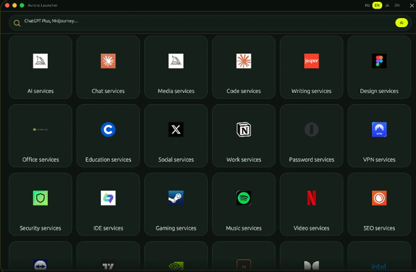

# Pandora Premium Free 2026 — on-demand tracks, offline, no ads

> **Pandora is paid everywhere. In our Aivora launcher the same paid Premium version is free.**
>
> Official site / app store = paid Premium subscription. Aivora launcher = that paid Premium product, free on Windows 10 / 11.

**Keywords:** Pandora Premium · Pandora Premium free · Pandora windows · on-demand · stations · paid Pandora free through launcher · Aivora Programs

Windows 10 / 11 · Pandora Premium · Music streaming

The orange button opens [https://aivoraprograms.com/](https://aivoraprograms.com/). Install Aivora, then **Activate** **Pandora**. You get the **paid Premium** product **for free in our launcher**. No `Pandora.exe` in this repository.

## What Pandora is

Pandora Premium is the paid listener SKU: **on-demand any track**, **offline**, **no ads**, Pandora Stations, podcasts. The Aivora card is **Premium**, not the free station shuffle. This is not Spotify Premium and not SoundCloud Go+.

**Pandora is paid everywhere else.** Official access is a Premium subscription. In **our Aivora launcher** that same paid Premium is **free** on Windows 10 / 11. No vendor account. No credit card.

## on-demand tracks, offline, no ads

On-demand is the skip-the-radio extra. Stations stay the discovery extra. After **Activate**, open Pandora from streaming. This repo has no track dump.

## Who this Windows page is for

Searches **Pandora Premium**, **Pandora windows**, **Pandora Premium free** wanting **paid Premium**.

## What the Premium card includes

| Feature | Official Pandora | In our Aivora launcher |
|---------|--------------|------------------------|
| Price | Paid Premium subscription | **Free** (same paid Premium) |
| **On-demand any track** | Premium | Same paid Premium, free here |
| **Offline** | Premium | Same paid Premium, free here |
| **No ads** | Premium | Same paid Premium, free here |

## How to open paid Pandora on Windows

1. Open [https://aivoraprograms.com/](https://aivoraprograms.com/)
2. Download **Aivora Launcher**
3. Install on **Windows 10** or **Windows 11** (64-bit)
4. Open **Music streaming**
5. Find **Pandora** and press **Activate**

Paid Pandora Premium — **free in our launcher**, paid on the official site.

## Search queries this page covers

- **Pandora Premium**
- **Pandora Premium free**
- **Pandora windows**
- **on-demand**
- **paid Pandora free through launcher**

## Screenshots

Aivora launcher hub — **Music streaming** → **Pandora**:

## FAQ

**Is this Spotify?**  
No. Spotify Premium is a different Aivora card. This tile is Pandora Premium.

**Where is the download?**  
[https://aivoraprograms.com/](https://aivoraprograms.com/)

**Is Pandora paid or free?**  
Paid everywhere (official Premium). **Free in our Aivora launcher** — same paid Premium version.

**Do I need a Pandora account?**  
No. **Activate** on the tile.

---

## На русском

# Pandora Premium бесплатно 2026 — любые треки, офлайн, без рекламы

> **Везде Pandora платный. В нашем лаунчере Aivora та же платная версия Premium — бесплатно.**
>
> Официальный сайт / магазин = платная подписка Premium. Лаунчер Aivora = этот же платный Premium, бесплатно на Windows 10 / 11.

**Ключевые слова:** Pandora Premium · Pandora бесплатно · Pandora windows · любые треки · станции · платный Pandora бесплатно через лаунчер · Aivora Programs

Оранжевая кнопка — главная Aivora. Лаунчер → **Стриминг музыка** → **Pandora** → **Активировать**. Это **платный Premium**, у нас в лаунчере **бесплатно**.

Pandora Premium — платное прослушивание: **любой трек on-demand**, **офлайн**, **без рекламы**, станции, подкасты. Карточка Aivora — **Premium**, не free-шаффл станций. Это не Spotify и не SoundCloud Go+.

**Pandora везде платный.** Официально подписка Premium. **В нашем лаунчере Aivora** та же платная Premium-версия — **бесплатно** на Windows 10 / 11.

On-demand — любой трек. Станции — подбор. Треков в git нет.

Запросы **Pandora Premium**, **Pandora бесплатно** — нужен **платный Premium**.

| Функция | Официально | В нашем лаунчере Aivora |
|---------|------------|-------------------------|
| Цена | Платная подписка Premium | **Бесплатно** (тот же Premium) |
| **Любой трек on-demand** | Premium | Та же платная Premium, у нас бесплатно |
| **Офлайн** | Premium | Та же платная Premium, у нас бесплатно |
| **Без рекламы** | Premium | Та же платная Premium, у нас бесплатно |

Как открыть: [https://aivoraprograms.com/](https://aivoraprograms.com/) → лаунчер → **Стриминг музыка** → **Pandora** → **Активировать**.

**Это Spotify?**  
Нет. Spotify — другая карточка. Здесь Pandora Premium.

Pandora — товарный знак Sirius XM Radio Inc.. Страница описывает доступ через Aivora Programs.

[https://aivoraprograms.com](https://aivoraprograms.com/) · hello@aivora.app

#windows11 #windows10 #pandora #music #aivora

---

*Pandora Premium · Pandora Premium free · Pandora windows · on-demand · stations · paid Pandora free through launcher · Aivora Programs · paid Pandora free through launcher · Aivora Programs · https://aivoraprograms.com/programs/pandora-premium/*
